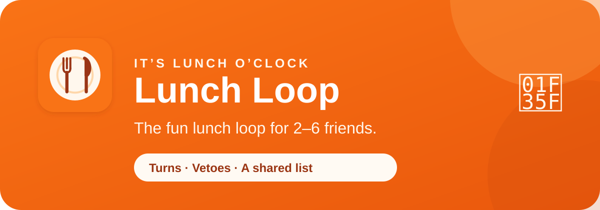

<p align="center">
  <a href="https://lunchloop.app">
    
  </a>
</p>

<p align="center">
  <a href="https://lunchloop.app"></a>
  <a href="https://lunchloop.app/whats-new"></a>
  <a href="https://lunchloop.app/privacy"></a>
</p>

<p align="center"><strong>The fun lunch loop for 2–6 friends.</strong><br />
Turns, vetoes, and a shared restaurant list—no more “you pick.”</p>

---

## 🍽️ What is Lunch Loop?

Lunch Loop turns the familiar “Where should we eat?” group-chat spiral into a
small, friendly ritual. Each private crew has its own restaurant database,
picker flow, one-veto-per-person decision, history, and increasingly
opinionated lunch lore.

It was built by [Craig Kohler](https://craigkohler.com) for real friends who
eat together often enough to want an answer that is quicker, fairer, and more
fun than “you pick.” It now supports multiple independent crews while keeping
each crew’s people, places, and history private to that crew.

**[Try Lunch Loop →](https://lunchloop.app)** · **[What’s New →](https://lunchloop.app/whats-new)** · **[Privacy →](https://lunchloop.app/privacy)**

## ✨ The loop, in a nutshell

| 1. Pick | 2. Veto | 3. Eat | 4. Remember |
| --- | --- | --- | --- |
| The picker chooses one place per crew member. | Everyone else gets one friendly veto. | The final surviving place wins. | Lunch Loop records the choice, visit, vetoes, and new facts for next time. |

### Two ways to loop

| Loop type | Built for | What happens next |
| --- | --- | --- |
| 🔁 **Standing** | A recurring lunch or dinner crew | The next picker follows the saved rotation after the meal is closed. |
| ✨ **Occasion** | A one-off or infrequent night out | Any crew member can start the next occasion and becomes that night’s picker. |

## 🌮 Highlights

- **A database that belongs to your crew.** Search Google Places inside a
  crew-controlled home area and radius; each crew keeps its own restaurants,
  contributors, history, visits, vetoes, and never-again list.
- **A fair, delightful decision flow.** The picker selects exactly one place
  per person. Everyone else gets one veto. The final pick is celebrated, not
  merely recorded.
- **Useful restaurant memory.** See who added a place, how often it won, how
  often it was vetoed, when it was last visited, hours at the planned meal
  time, Google details, directions, and a map.
- **Built for real phones.** Mobile-first design, install guidance for iPhone
  and Android, an installable PWA, live updates, dark mode, and a consistent
  small-screen picker.
- **Made to grow naturally.** Owner-managed invitations by email or short
  shareable code, multi-loop accounts, per-loop time zones and search areas,
  feedback, and a protected Global Admin view.
- **Stats without pressure.** History, cuisine popularity, veto heat maps,
  monthly recaps, picker win rates, and little facts as a crew’s story grows.

## 🔐 Privacy and product boundaries

Lunch Loop is invite-only today. A member can see only the Lunch Loops they
belong to; database row-level security enforces that boundary server-side.
Sign-in is Google (`openid`, `email`, and `profile`) or a one-time email
link. Lunch Loop does not use passwords. Google is also used for optional
place details—not Gmail, Drive, Calendar, contacts, or device location.
Feedback can optionally include a name for a public thank-you in release
notes; that credit is off unless the person turns it on.

The repository intentionally contains **no production credentials, user data,
database backups, webhook URLs, or deployment linkage**. Use the safe
[`.env.example`](.env.example) template for a local environment and keep
actual values in `.env.local`.

Read the full [Privacy Policy](https://lunchloop.app/privacy) and
[Terms of Use](https://lunchloop.app/terms).

## 🧰 Built with

| Layer | Technology |
| --- | --- |
| App | Next.js App Router, React, TypeScript, Tailwind CSS |
| Data and auth | Supabase Postgres, Auth, Row Level Security, Realtime |
| Places | Google Places API (New) |
| Notifications | Optional Resend transactional email and Discord webhooks |
| Hosting | Vercel |
| Phone experience | Progressive Web App manifest, icons, install guidance, foreground refresh |

## 🚀 Run it locally

You need Node.js, Docker Desktop (for local Supabase), a Supabase project or
local Supabase instance, and a Google Places API key.

```bash
cp .env.example .env.local
npm install
npm run dev
```

For the complete setup—including Docker, Supabase migrations, OAuth, backups,
email, Google Places restrictions, and production deployment—read
[Development and Deployment](docs/DEVELOPMENT.md) before pointing the app at
real data.

## 📚 Project guide

| Start here | What it covers |
| --- | --- |
| [Product and User Guide](docs/PRODUCT.md) | Loop types, daily workflow, roles, invitations, data boundaries, and restaurant-copy behavior. |
| [Development and Deployment](docs/DEVELOPMENT.md) | Local prerequisites, environment variables, Supabase, migrations, tests, backups, and Vercel. |
| [Operations and Security](docs/OPERATIONS.md) | Production operations, security controls, incident recovery, and admin responsibilities. |
| [Integrations](docs/INTEGRATIONS.md) | Google OAuth/Places, Supabase, Resend, forwarding addresses, and Discord. |
| [Release Notes](docs/RELEASE_NOTES.md) | Build-by-build history of the product. |
| [Roadmap](docs/ROADMAP.md) | Private beta priorities, public-launch gates, and respectful monetization ideas. |
| [Documentation Index](docs/README.md) | The full maintainer map. |

## 🛣️ The project story

Lunch Loop started as an Evansville-area lunch tool for a small friend group:
take turns, pick a few places, let the others veto, and stop overthinking it.
It has grown carefully into a multi-loop foundation so another friend group can
have its own city, radius, time zone, people, places, history, and stats—without
mixing data with anyone else.

The next phase is a small real-world beta: validate independent crews,
multi-loop membership, time zones, invitations, support, Google Places
attribution/retention, and measured provider costs before broad public growth.
The detailed plan is in the [roadmap](docs/ROADMAP.md).

## 🤝 Feedback and contributions

Lunch Loop is actively evolving. Signed-in members can use the in-app Feedback
screen for bugs, ideas, questions, and notes. For source feedback, open an
issue with the steps to reproduce, expected behavior, and a screenshot when it
helps. Please start a conversation before opening a large pull request so the
change fits the product direction and privacy model.

## 👋 Creator

Created and maintained by [Craig Kohler](https://craigkohler.com).

<p align="center">
  <a href="https://lunchloop.app"><strong>lunchloop.app</strong></a> ·
  <a href="https://craigkohler.com"><strong>craigkohler.com</strong></a> ·
  <a href="https://lunchloop.app/whats-new"><strong>Build 2026.10.23.64</strong></a>
</p>
