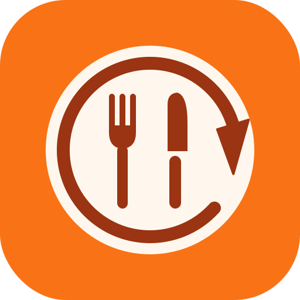
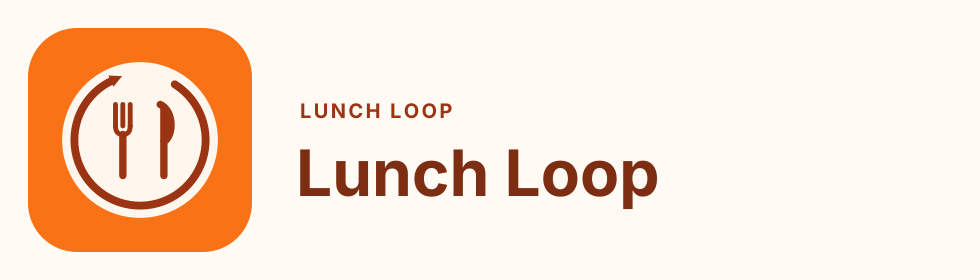
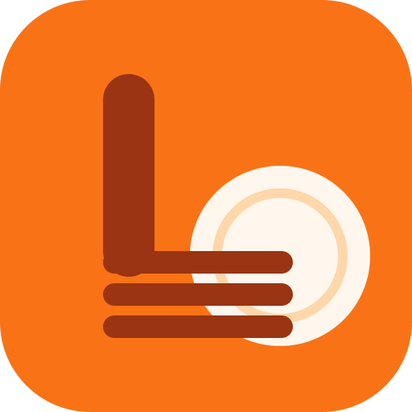

# Lunch Loop design guide

Living notes for how Lunch Loop should look and sound. The app code is the
source of truth for what is on screen today. This guide is the source of truth
for what to do next time, and for the choices that are still Craig’s.

Update this file in the same change as a visual or copy change. Add a dated
line under [Changelog / open questions](#changelog--open-questions). Do not
treat the guide as frozen.

Current live icon: `public/favicon.svg`, plus `src/app/icon.png`,
`src/app/apple-icon.png`, and `src/app/favicon.ico`. **Do not replace it**
until Craig picks a concept from [Logo](#logo).

## How to use this

- Match an existing component before inventing a new one.
- Public pages (landing, sign-in, join, start, support, privacy, terms) and
  the signed-in app share one brand. Global Admin may be denser. It is an
  operator tool, not a marketing page.
- A finished pick’s thank-you (receipt, one-liner, or tip jar) is part of the
  result, not a banner stuck on afterwards.
- If a screen needs something this guide does not cover, add the rule here
  instead of leaving it only in a component.

## Brand story and personality

Lunch Loop is a small tool for a real group of friends deciding where to eat.
Two to six people. A shared list. Turns. One veto each. Then someone closes
the loop and the next person is up.

The feeling is a weeknight lunch, not a startup launch and not a loyalty
program.

- **Friends first.** Copy talks to the crew (“your friends”, “the next
  person”), not to “users”.
- **Value for Value.** The app is free. There are no ads and no paid
  placements. If support is turned on, a finished pick can leave a quiet
  thank-you. A couple of bucks is plenty. Ignoring it is a complete response.
- **Honest.** Counts on a receipt are real (crew size, lunches closed, vetoes)
  or a joke marked VOID. Never invent a statistic to make the ask feel earned.
- **Light, not cute-for-its-own-sake.** One plate, one orange, short sentences.
  Emoji are seasoning (a meal, a party popper), not the layout.
- **Private.** A crew’s restaurants, names, and decisions stay with that crew.
  Link previews must not reveal who invited whom. See [Social images](#social-and-share-images).

Personality in one line: a friend who already looked up the hours, saved you
the group chat, and will not guilt you about the bill.

## Logo

### Live mark

The shipping icon is a cream plate on orange `#F97316`, with a fork and knife
in `#9A3412` and a peach inner ring `#FED7AA`. The tile uses a 112px corner
radius on a 512px canvas (the same proportion as `rounded-[22%]`). It is the
favicon, the Apple touch icon, the README hero, and the share image.

It is recognizable at 16px. It does not yet carry a hidden meaning. That is
the open question below. Leave the live files alone until Craig chooses.

### Concepts

Three studies live in `docs/brand/`. Each is a 512×512 SVG in the same flat
colors as the live icon, so any of them can replace it without a new palette.
PNG previews sit beside the SVGs. None of them is in production.

#### 1. Plate Loop — recommended

Files: `docs/brand/logo-plate-loop.svg`, `docs/brand/logo-plate-loop.png`.

The plate rim is not a closed ring. It is a circular arrow: almost a full
turn, with a gap and an arrowhead. The fork and knife stay in the middle, so
anyone who already knows the app still sees a plate.

Hidden meaning: the loop is the plate. You sit down, decide, close it, and
come around again.

Why this is the recommendation:

- It keeps the current silhouette. A favicon change that still reads as “the
  plate” will not feel like a different product.
- The trick does not depend on reading a letter. At 32px the arrow softens,
  and what remains is still a plate, fork, and knife.
- It matches the product noun. The thing the app is named for is drawn.

Lockup, for social and docs only. The wordmark is Inter Bold converted to
paths so the SVG does not depend on a font. The website itself still uses
Arial.

`docs/brand/logo-plate-loop-lockup.svg`

#### 2. Fork L

Files: `docs/brand/logo-fork-l.svg`, `docs/brand/logo-fork-l.png`.

The fork is bent into a capital L. The handle is the stem. Three tines, all
the same length, are the foot. A cream plate sits under the foot.

Hidden meaning: L for Lunch and for Loop. One letter, doing both jobs.

At 512px the tines read as a fork. At 32px the gaps collapse and the mark
reads as a solid L on a plate, which is still legible. The knife is gone, so
it is a bigger departure from the live icon. Strong second choice if Craig
wants the letter more than the loop.

#### 3. Tray LL

Files: `docs/brand/logo-tray-ll.svg`, `docs/brand/logo-tray-ll.png`.

A cafeteria tray, seen from above, with a thumb notch on the near edge. The
two wells are a pair of L letters.

Hidden meaning: LL, Lunch Loop, is the lunch tray.

This is the most literal of the three, and it still reads as LL at 32px. It
is also the busiest, and it no longer looks like the plate people already
have on their home screen. Choose it if spelling the name matters more than
continuity.

### If Craig picks one

1. Replace `public/favicon.svg` with the chosen SVG (keep the 512 viewBox and
   the 112px corner radius).
2. Regenerate `src/app/icon.png`, `src/app/apple-icon.png`, and
   `src/app/favicon.ico` from that SVG. Do not leave the old PNGs behind.
3. Bump the build so cached `?v=` icon URLs refresh.
4. Move the chosen note in this section from “recommended” to “live”, and
   keep the other studies so the decision stays visible.
5. The share image (`src/app/opengraph-image.tsx`) reads `src/app/icon.png`,
   so it follows the new mark on the next build.

## Color

The orange is the brand. Cream is the paper. Stone is the ink. Do not add a
second brand hue.

| Name | Hex | Where it goes |
| --- | --- | --- |
| Orange | `#F97316` | Primary buttons, the decision hero, the app icon tile, theme-color. Tailwind `orange-500`. |
| Orange hover | `#EA580C` | Hover on those buttons (`orange-600`). |
| Orange deep | `#C2410C` | Pressed or emphasis orange when white text must be readable. `orange-700`. |
| Orange ink | `#9A3412` | Fork and knife, links on cream, receipt accent in light mode. `orange-800`. |
| Orange heading | `#7C2D12` | Public page titles (`orange-950` is close; email headings use this hex). |
| Peach ring | `#FED7AA` | Icon inner ring, soft borders. `orange-200`. |
| Peach wash | `#FFEDD5` | Email card border, quiet highlights. `orange-100`. |
| Cream | `#FFFAF3` | Page background on public pages and the app body. |
| Cream card | `#FFF7ED` | Icon plate, email page background. `orange-50`. |
| Receipt paper | `#FFFDF8` | Light-mode receipt only. Not a general surface. |
| Ink | `#292524` | Body text. `stone-900` / `stone-800`. |
| Ink soft | `#57534E` | Secondary text. `stone-600`. Passes on white. |
| Line | `#FFEDD5` to `#E7E5E4` | Hairline borders. Orange-tinted on public chrome, stone on form fields. |
| Success wash | `#ECFDF5` / `#064E3B` | Confirmation text on a green wash. |
| Warning wash | `#FFFBEB` / `#78350F` | Sign-in errors and cautions. |
| Danger | `#E11D48` family | Destructive actions and form errors. Rose, never orange. |

### Contrast

Measured as WCAG contrast ratio. Normal text needs 4.5:1. Large or bold text
(about 18px regular or 14px bold) needs 3:1.

| Pair | Ratio | Use |
| --- | --- | --- |
| `#292524` on `#FFFAF3` | 14.6:1 | Body on the page. |
| `#57534E` on `#FFFDF8` | 7.5:1 | Receipt secondary lines. |
| `#7C2D12` on `#FFF7ED` | 8.8:1 | Headings on cream. |
| `#9A3412` on `#FFFFFF` | 7.3:1 | Links and the light-mode receipt button label (white on `#9A3412`). |
| `#FFFFFF` on `#C2410C` | 5.2:1 | White label on deep orange. Passes for normal text. |
| `#FFFFFF` on `#F97316` | 2.8:1 | White label on the brand orange. Fails. |
| `#FFEDD5` on `#F97316` | 2.5:1 | Orange-100 kicker on the hero. Fails. |

The bright orange button and the white hero type are the current look, and
this pass did not darken them. They are an open question, not a license to
put more small white text on `#F97316`. New small text on the hero goes on a
white or cream chip (the one-liner, the tip jar, the schedule card, the
receipt). The receipt button already uses white on `#9A3412`.

Dark-mode receipt pairs are in [Dark mode](#dark-mode). `#F8F1EB` on
`#2A231E` is 13.8:1. `#D0C1B6` on `#2A231E` is 8.8:1. `#2A1205` on `#FB923C`
is 7.8:1.

## Typography

The UI font is Arial, Helvetica, sans-serif, set on `body` in
`src/app/globals.css`. Do not load a webfont for the app. The receipt is the
exception: `ui-monospace, "SF Mono", Menlo, Consolas`, so it feels like a
printed slip.

| Role | Classes | Notes |
| --- | --- | --- |
| Landing display | `text-5xl sm:text-6xl lg:text-7xl font-black tracking-[-0.055em]` | One per page. The only place type gets this large. |
| Public page title | `text-4xl sm:text-5xl font-black text-orange-950` | Support, privacy, terms. |
| App page title | `text-3xl font-black tracking-tight` | One `h1` inside the app frame. |
| Section title | `text-xl font-black` or `text-lg font-black` | `h2`. Do not skip from `h1` to a plain bold paragraph. |
| Eyebrow | `text-xs` or `text-sm font-black uppercase tracking-widest` | Short. On cream, color is `text-orange-600`. On the hero, `text-orange-100` (see contrast). |
| Body | default size, `leading-6` or `leading-7` on public pages | `text-stone-700` on cream, `text-orange-50` on the hero. |
| Secondary | `text-sm leading-6 text-stone-600` or `text-xs leading-5 text-stone-500` | `stone-500` on white is about 4.8:1. Fine for captions, not for instructions. |
| Button label | `text-sm font-black` | Sentence case. Emoji, if any, sits after the words. |

The receipt’s restaurant name is `text-lg font-black` and may wrap anywhere
(`overflow-wrap: anywhere`) because place names can be one long token.

Do not add a root `title` template in `layout.tsx`. Page titles already end
with “Lunch Loop” where they need to. A template would double the brand.

## Spacing and layout

The scale is Tailwind’s default 4px grid. Prefer these steps and do not invent
one-off margins.

| Token | Size | Typical use |
| --- | --- | --- |
| 2 | 8px | Inside a compact chip. |
| 3 | 12px | Stacked form controls, tight card gaps. |
| 4 | 16px | Page padding on a phone, gap between the result and the thank-you. |
| 5 | 20px | Space under a hero action in the single-column hero. |
| 6 | 24px | App header padding, wider page padding from `sm`. |
| 8 | 32px | Footer padding. |
| 10–14 | 40–56px | Public article padding (`py-10 sm:py-14`). |

Page shells:

| Surface | Max width | Padding |
| --- | --- | --- |
| Signed-in app | `max-w-5xl` | `px-4 md:px-6` |
| Landing | `max-w-6xl` | `px-4 sm:px-6 lg:px-8` |
| Privacy and terms | `max-w-4xl` | `px-4 sm:px-6` |
| Support | `max-w-3xl` | `px-4 sm:px-6` |
| Sign-in card | `max-w-md` | page `p-4`, card `p-7` |
| Join card | `max-w-lg` | same |

These widths are different on purpose. A policy should be a readable column.
The app should use the width. Do not squeeze privacy down to the support
column, and do not stretch support out to the landing hero.

### Chosen-pick layout

On a phone the order is: restaurant result, thank-you, then schedule and close.
The thank-you is full width of the hero, not a narrow slip floating in the
middle.

From 768px up, and only when a thank-you is actually showing, the hero becomes
two columns: `minmax(0, 1fr)` and `minmax(16.5rem, 22rem)`, top-aligned, with
a 1.5rem gap. The result and the actions stay in the left column. The receipt,
one-liner, or tip jar fills the right column. An empty nudge is `display: none`,
so a hidden thank-you does not leave a blank column. The fries decoration is
hidden in this state so it does not sit behind the slip.

The rules live in `.pick-layout` in `src/app/globals.css`.

## Components

### Buttons

Primary: `inline-flex min-h-11 items-center justify-center rounded-xl bg-orange-500 px-4 py-3 text-sm font-black text-white`.

- Height is at least 44px (`min-h-11`), including the landing Sign in link.
- Radius is `rounded-xl` (12px). Not `rounded-2xl`, and not a hover that
  lifts the button.
- Hover is `hover:bg-orange-600`. Disabled is `disabled:opacity-60`.
- One primary button per cluster. A second action is the secondary style.

Secondary: white or cream fill, `text-orange-800` or `text-stone-700`,
`rounded-xl`, `ring-1 ring-orange-100` or `border border-orange-200`, also
`min-h-11`.

Text button: `font-bold text-orange-700 underline` or `text-orange-800`. Use
for “Not now”, “Use a different email”, and legal links. Still give a tappable
row at least 44px tall when it is the only action in that row (`min-h-11`).

Destructive: `bg-rose-600` or `bg-rose-700`, white label, same radius and
height. Never orange.

The receipt’s “Fuel the loop” button is a pill (`rounded-full`) on the receipt
colors, not an orange-500 button. That is deliberate: white on `#F97316` fails
contrast, and the pill belongs to the slip.

### Cards

- App cards: `rounded-3xl bg-white p-5 shadow-sm`, sometimes `ring-1 ring-orange-100`.
- Decision hero: `rounded-3xl bg-orange-500 text-white shadow-lg shadow-orange-200`.
  Padding `p-6`, or `p-4 sm:p-6` when the thank-you is in the hero.
- Nested info on the hero (the winning restaurant, the schedule): `rounded-2xl`
  on a light fill so the text is not white-on-orange.
- Public form cards (sign-in, join): `rounded-3xl bg-white p-7 shadow-xl shadow-orange-100`.

### Receipt, one-liner, tip jar

All three are the same slot. They do not add their own top margin or a
`max-w-sm` / `max-w-xl` centered column. The layout grid is the spacing.

Receipt:

- Paper, not a Tailwind `bg-white` or `text-stone-*` utility. Dark mode
  remaps those utilities and would repaint the slip the wrong color. Colors
  come from `.lunch-receipt-sheet` variables.
- Light paper `#FFFDF8`, ink `#292524`, muted `#57534E`, accent `#9A3412`,
  rules `#E7D3C4`, border `#F0C9A0`.
- Torn bottom is a sibling with a zigzag `clip-path`, so the orange hero
  shows through the teeth.
- Line items wrap. Joke values are the word VOID, not a fake number.
- Decision fee is `$0.00` because that is the fee.

One-liner: a white chip, `rounded-2xl`, `text-sm text-stone-800`, the link in
`font-black text-orange-800` with an orange underline. “Not now” sits on the
same row and wraps under the sentence when the column is narrow.

Tip jar: the same white chip, a small mason-jar drawing, and “Tip the loop?”.
The coin drops once (`.lunch-coin`). `prefers-reduced-motion` sets that
animation to none and hides the coin.

### Forms

- Label: `text-sm font-black`, the input directly under it (`mt-2`).
- Field: `w-full rounded-xl border border-orange-200 px-3 py-3 text-base outline-none focus:ring-2 focus:ring-orange-300`.
- `text-base` (16px) is required. iOS Safari zooms the page when a focused
  field is under 16px. `globals.css` also forces 16px on text fields below
  768px.
- Date and time fields use `.date-time-input` so Safari’s inner date parts
  line up with the rest of the control. They are already `text-base` and
  `h-11`.
- Errors: `role="alert"`, `rounded-xl bg-rose-50`, `text-sm font-bold text-rose-700` or `text-rose-800`.
- Success: `role="status"`, `rounded-xl bg-emerald-50`, emerald text.

### Navigation

Signed-in primary nav is the bottom bar: `fixed` on small screens,
`md:sticky`, with `pb-[max(0.5rem,env(safe-area-inset-bottom))]` so the home
indicator does not cover the tabs. The main column uses `pb-24` on small
screens so the last card clears the bar.

Tabs are `text-[10px] font-bold` with an emoji. Active tab is `bg-orange-100 text-orange-800`.

Public pages have a simple header: plate emoji in an orange rounded tile, the
words Lunch Loop, and one action on the right (Sign in, or Back).

### Footer

Centered, `text-xs leading-5 text-stone-500`. Link rows use
`flex flex-wrap justify-center gap-x-3 gap-y-1` so Privacy and Terms wrap
instead of overflowing a phone.

“Lunch Loop is run by Craig Kohler.” stays. “Fuel the loop” appears only when
`donations_enabled` is on, and never on `/support` itself.

### Toasts and inline notes

There is no toast library and no modal. Feedback, errors, and the support
nudge are inline.

- A note inside a page uses `role="status"` or `role="alert"` and a tinted
  rounded rectangle. It does not float over the restaurant.
- The post-decision feedback prompt is a full-width strip in the header, with
  a real “Not now”. It is not a dialog.
- Do not add a pop-up, a snackbar, or a blocking overlay for support.

### Empty and error states

`EmptyState` in `src/components/app-frame.tsx`: dashed `border-orange-200`,
white card, `rounded-3xl`, one emoji, an `h2`, and a short sentence. One
primary action, and a secondary action if there is a real second path (create
a loop vs enter a code).

Connection failures are a rose-tinted section with “Try again” and “Refresh
page”, in that order. Say what happened in a sentence. Do not show a stack
trace, a status code, or the word “error” as the heading.

Loading copy is a sentence (“Loading your Lunch Loop…”), then a slower line
and the two buttons if it keeps failing. Not a spinner-only view.

## Iconography

- The product icon is the plate. Public headers currently use the 🍽️ emoji in
  an orange rounded square as a stand-in. That is acceptable until a logo is
  chosen. Do not mix in other plate drawings.
- UI emoji already in the product (meal, veto scissors, trophy, party popper)
  can stay. Do not add a new emoji as a section’s only heading.
- The tip jar is a small inline SVG, two colors plus the coin. New spot
  illustrations follow that: a few paths, brand hexes, no gradients.
- External marks (Google on the sign-in button) stay plain text unless Craig
  asks for the official logo, which has its own rules.

## Illustration

Flat shapes. Two or three colors from the palette. No drop shadows inside an
icon, no gloss, no 3D plate, no photograph in the chrome.

The landing page may use a large soft orange panel as a preview of the
product. It is a layout sample, not an illustration set. Do not commission a
mascot.

Restaurant photos, if a screen ever shows them, come from the place itself.
They are content, not brand art.

## Motion

Almost none.

- Allowed: color change on hover, the install-guide pulse
  (`.install-pulse`), and one coin drop on the tip jar.
- Not allowed: buttons that translate on hover, looping motion on the receipt,
  or anything that moves the restaurant card.
- `@media (prefers-reduced-motion: reduce)` disables the install pulse and the
  coin. New animation goes in that same block.

## Dark mode

`data-theme="dark"` on the document element remaps the common utilities
(`.bg-white`, `.text-stone-*`, `.text-orange-*`, borders) in `globals.css`.
It does **not** remap `bg-orange-500` or `text-white`. The orange hero stays
orange.

Prefer those utilities for ordinary cards so dark mode comes along. Do not
set a one-off hex on a card unless it is a special surface.

The receipt is a special surface. It keeps its own variables, including a
dark pair:

| | Light | Dark |
| --- | --- | --- |
| Paper | `#FFFDF8` | `#2A231E` |
| Ink | `#292524` | `#F8F1EB` |
| Muted | `#57534E` | `#D0C1B6` |
| Accent | `#9A3412` | `#FFB36B` |
| Button | `#9A3412` / white | `#FB923C` / `#2A1205` |
| Rule and border | `#E7D3C4` / `#F0C9A0` | `#5C4838` |

Theme choice lives in account settings (system, light, dark). The first paint
must not flash the wrong theme; `ThemeInitializer` is responsible.

## Accessibility

- One `h1` per page. The hero title is that `h1` on the pick screen.
- Icon-only controls need an accessible name. The receipt section is named
  “Value for value”.
- Focus rings stay visible (`focus:ring-2`). Do not remove outlines on the
  hero’s restaurant button.
- Tap targets are at least 44px on primary actions. The bottom nav items are
  `min-w-14` with vertical padding.
- Contrast: follow the table above. Do not put new `text-xs` white type on
  orange-500.
- Status messages use `role="status"`. Errors use `role="alert"`.
- The thank-you can be dismissed and does not trap focus. It is not a dialog.
- Long names wrap (`break-words`, and `overflow-wrap: anywhere` on the receipt
  and the hero title). Nothing in the hero should force horizontal scrolling
  at 375px.
- Respect `prefers-reduced-motion`.

## Voice and tone

Short, warm, specific. Say what the person can do. Do not sell.

### Do

- “Enjoy lunch, then close the loop so the next person can make the next set of picks.”
- “A couple of bucks is plenty.”
- “Not now.”
- “You’re invited to Lunch Loop.”
- “Support isn’t open right now.”
- “Lunch Loop is free. If it helped your crew decide lunch, you can send some value back.”

### Don’t

- Guilt. “You haven’t chipped in yet.” “Your friends already donated.”
- A specific dollar amount, a suggested price, or a progress bar toward a goal.
- Ads, sponsorship, or “featured restaurant” language. The product has none.
- Fake counts. “Group texts saved: 12” is not a thing the app measures.
- In-jokes that only one listener would get, on any public page.
- Startup voice. “Supercharge your lunch workflow.” “Delightful meal decisions, unlocked.”
- Apology padding. “Oops! Something went wrong on our end.” Say the sentence.

### Support, specifically

The nudge is a thank-you, not a checkout. “Fuel the loop” is the link. The
receipt can be playful (VOID lines, “Thank you for eating with us!”) because
it is clearly a paper slip with a $0.00 fee. The `/support` page is plainer:
what the project is, that a couple of bucks is plenty, that it is not
tax-deductible, and a button to Stripe that opens in a new tab.

`/support` copy is still a draft for Craig. Change the words in
`src/app/support/page.tsx` and note it in the changelog. Do not add a disclaimer
banner on the page itself.

When `donations_enabled` is off, the nudge, the footer link, and the Stripe
button are absent. The page says support isn’t open. A missing environment
variable fails the same way: off, not a flash of the button.

## Email

Transactional mail uses `lunchLoopEmailDocument` in `src/lib/email.ts`.
Callers pass already-escaped HTML. The shell is:

- Page background `#FFF7ED`, card white, 16px radius, 1px `#FFEDD5` border.
- Max width 560px.
- Eyebrow “LUNCH LOOP” in `#9A3412`, 12px, tracked out.
- Heading `#7C2D12`, 24px.
- Body `#292524`, 16px, Arial.
- Button `#F97316`, white, 12px radius, weight 800, padding 12px 18px.

The plain-text part stays. Do not send HTML without it. Invitation meaning
does not change to fit the shell: who it is for, the one-time code, and the
14-day expiry stay in the body.

Magic-link mail is sent by Supabase, not by this template.

## Social and share images

Friends paste invite links. The preview should say Lunch Loop, not a generic
host, and not the name of the crew.

- `metadataBase` is `https://lunchloop.app`.
- `src/app/opengraph-image.tsx` draws a 1200×630 card: cream background, the
  live app icon, “The fun lunch loop for friends.”, and “2–6 friends. Turns,
  vetoes, and a shared list.”
- `src/app/twitter-image.tsx` reuses that image. The card is
  `summary_large_image`.
- `/join` title: “Join a Lunch Loop”. Description invites the person to sign
  in once. It does not include the crew name. The token is in the query
  string and must not be copied into the title or description.
- `/start` title: “Build a Lunch Loop”.
- Sign-in metadata lives in `src/app/sign-in/layout.tsx` because the page is
  a client component and cannot export `metadata`.
- Public pages set their own `openGraph.title` and repeat the share image.
  A page that sets `openGraph` without `images` drops the picture. There is
  no title template, on purpose.

Favicon links are cache-busted with `?v=` plus the build number.

## Mobile

Design and check at 375px wide, then at 768px and 1280px.

- Public pages and the app use `min-h-dvh`, not `100vh`, so the iOS toolbar
  does not cover the bottom.
- The tab bar clears the home indicator (see Navigation).
- Columns that sit side by side from 768px stack under that.
- No horizontal scroll. Long restaurant names wrap.
- Inputs are 16px so Safari does not zoom.
- Primary actions are at least 44px tall.
- This environment cannot run Mobile Safari. Phone checks are Chrome at a
  375px-wide viewport, plus the CSS rules above.

## Page notes from the 2026-10-23 pass

What changed, and what was looked at and left alone.

| Page | Change |
| --- | --- |
| Pick / home hero | Thank-you column on wide screens. Stacked under the result on a phone. Hero padding tightened only in the chosen state. |
| Landing | Sign in and the main action are `rounded-xl` and at least 44px. Removed the hover lift. Footer links wrap. Display type and the two-column hero stayed. |
| Sign-in | 16px email field, 44px buttons, share title. |
| Join and start | Same button and field rules. Share titles that do not leak the crew. |
| Support | Back link is 44px. Footer already wrapped. Copy unchanged. |
| Privacy, terms, What’s New | Back link height, wrapping footer, share titles. Column width unchanged. |
| App footer | Link row wraps. |
| Email | One shared shell. Wording of each invitation kept. |
| Loop list, settings, account, feedback, install, admin | Already on the app type scale and orange buttons. Not restyled. Admin may keep `text-xs` and `rounded-lg` in dense rows. |

## Changelog / open questions for Craig

### Changelog

- **2026-10-23.** First edition. Wrote down the orange-plate system that is
  already shipping. Added Plate Loop, Fork L, and Tray LL. Did not change the
  live icon. Moved the finished-pick thank-you beside the result on wide
  screens. Added the share image and the email shell.

### Open questions

1. **Which logo, if any?** Recommendation is Plate Loop. Fork L if you want a
   letter. Tray LL if you want “LL” spelled in the icon. The live plate stays
   until you say otherwise.
2. **White on `#F97316`.** Buttons and the hero heading use it, and the
   contrast is 2.8:1. Leave the bright orange as the brand, or move primary
   buttons to `#C2410C` (5.2:1) and keep `#F97316` for large areas only?
3. **Hero eyebrow.** `text-orange-100` on the orange hero is 2.5:1. Keep it
   as a quiet kicker, or switch that one line to white / cream?
4. **Page widths.** Landing is `max-w-6xl`, the app is `max-w-5xl`, policies
   are `max-w-4xl`, support is `max-w-3xl`. This guide treats that as
   intentional. Say if you want them unified.
5. **`/support` words.** Still a draft. Edit the page when you want the public
   version, and add a changelog line.
6. **Share images and crew names.** This guide says invite previews stay
   generic so a forwarded link does not announce the crew. Confirm that, or
   ask for a per-loop image later (it would need a careful privacy pass).
7. **Emoji plate in the header.** Fine until a logo is chosen. After that,
   decide whether the header uses the SVG or keeps the emoji.
8. **One-liner list.** Eight lines live in `src/lib/donation.ts`. Replace any
   that do not sound like you. Keep them short, and keep them free of guilt.
